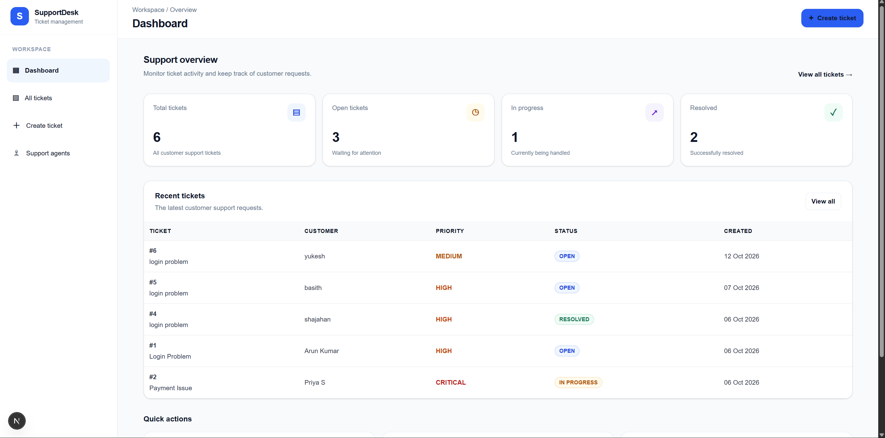
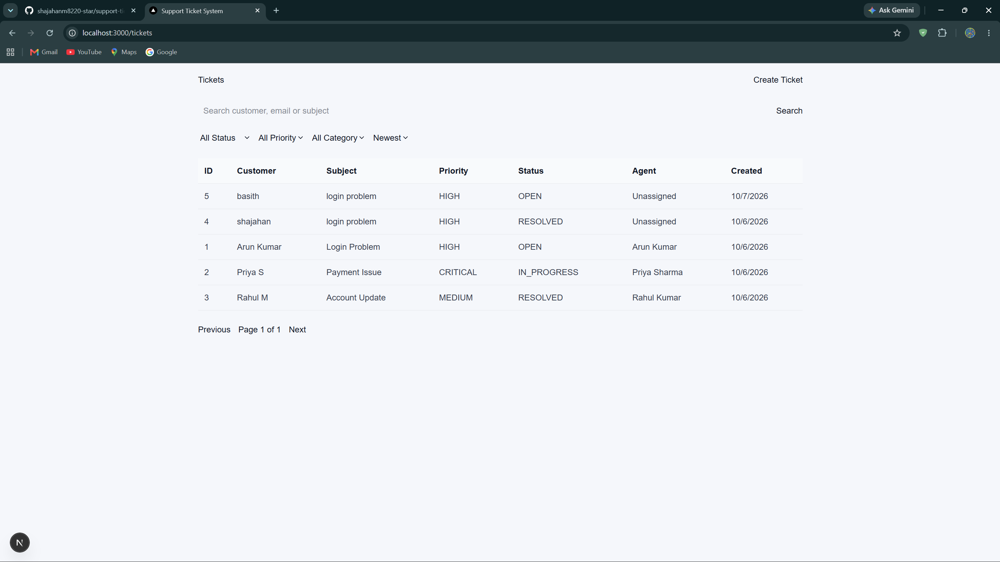
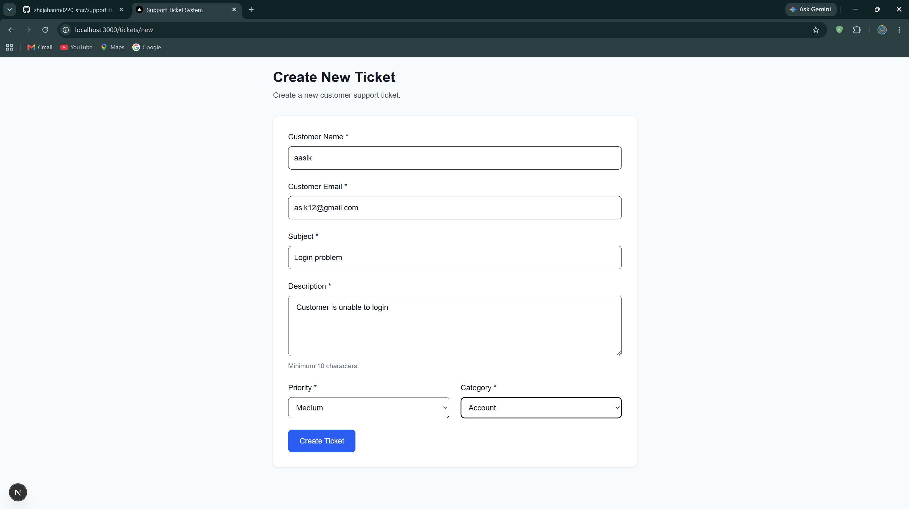
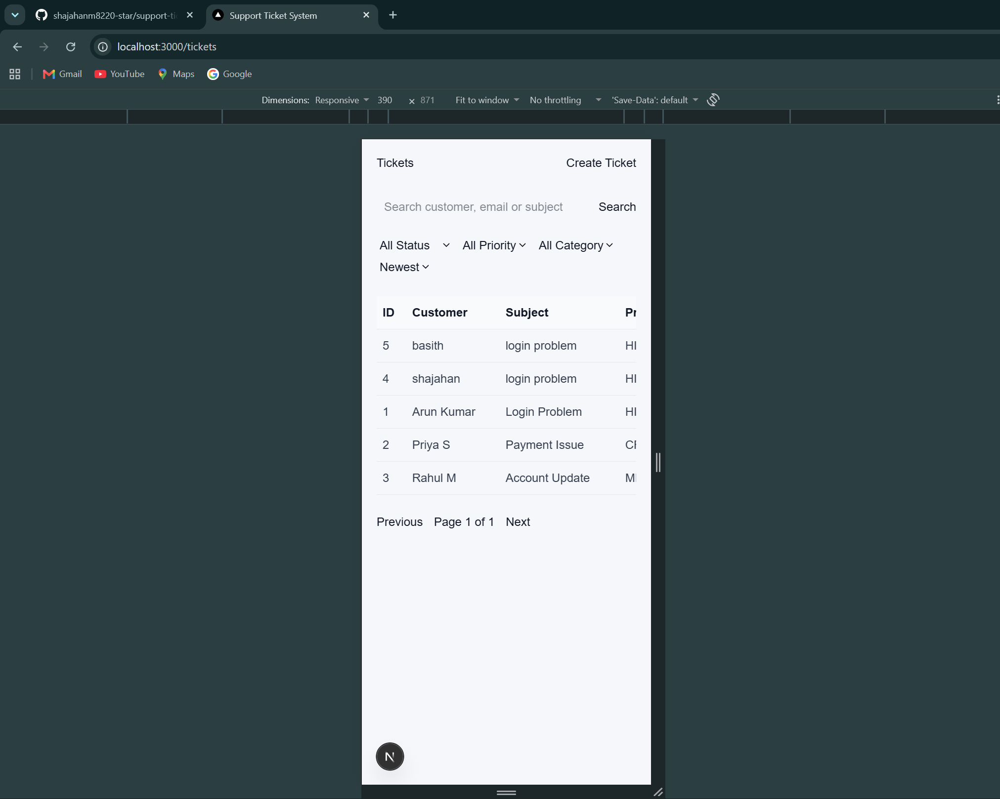

# Support Ticket Management System

A full-stack web application for managing customer support tickets, built with Next.js, TypeScript, Express.js, and MySQL.

## Overview

The Support Ticket Management System helps support teams manage customer issues through a centralized application.

Users can create tickets, view ticket details, search and filter tickets, manage ticket status, and assign support agents. The backend provides REST APIs, while MySQL stores the application data.

## Features

### Dashboard
- View total ticket statistics.
- Monitor ticket statuses.
- View recent tickets.
- Retrieve dashboard information from the backend API.

### Ticket Management
- Create support tickets.
- View all tickets.
- View individual ticket details.
- Search tickets by customer name, customer email, or subject.
- Filter tickets by status, priority, category, and assigned agent.
- Sort ticket listings.
- Paginate ticket results.
- Update ticket information.
- Update ticket status.
- Assign support agents to tickets.
- Delete tickets if the delete functionality is implemented.

### Agent Management
- Retrieve support agents.
- Display agent information.
- Assign agents to tickets if supported by the application.

### Additional Features
- MySQL database integration.
- REST API integration.
- Environment-based configuration.
- Responsive user interface.
- Loading, error, and empty states where implemented.

> Only retain features that are implemented and working in the submitted version.

## Technology Stack

### Frontend
- Next.js 16
- React
- TypeScript
- Tailwind CSS
- HTML and CSS

### Backend
- Node.js
- Express.js
- TypeScript
- REST APIs

### Database
- MySQL
- MySQL Workbench

### Development Tools
- Visual Studio Code
- Git
- GitHub
- npm
- PowerShell

## Architecture

The application uses a frontend-backend-database architecture.

```text
User
 |
 v
Next.js Frontend
 |
 | HTTP Requests / JSON Responses
 v
Express.js Backend
 |
 | SQL Queries
 v
MySQL Database
```

### Request Flow

1. The user interacts with the Next.js frontend.
2. The frontend sends an HTTP request to the Express.js backend.
3. The backend processes and validates the request.
4. The backend reads or updates information in MySQL.
5. The backend returns a response.
6. The frontend displays the result.

## Project Structure

```text
support-ticket-system/
|
|-- backend/
|   |-- src/
|   |   |-- controllers/
|   |   |-- routes/
|   |   |-- db.ts
|   |   |-- server.ts
|   |-- package.json
|   |-- tsconfig.json
|   |
|-- frontend/
|   |-- app/
|   |   |-- agents/
|   |   |-- tickets/
|   |   |   |-- new/
|   |   |   |-- [id]/
|   |   |-- page.tsx
|   |   |-- layout.tsx
|   |   |-- globals.css
|   |-- lib/
|   |-- package.json
|   |
|-- screenshots/
|
|-- database.sql
|-- README.md
|-- .gitignore
```

The structure above shows the main project files. Additional files may exist in the frontend and backend directories.

## Prerequisites

Install the following software:

- Node.js and npm
- MySQL Server
- MySQL Workbench (recommended)
- Git
- Visual Studio Code

Verify Node.js, npm, and Git:

```bash
node --version
npm --version
git --version
```

Make sure MySQL Server is running before starting the backend.

## Installation

### 1. Clone the Repository

```bash
git clone https://github.com/shajahanm8220-star/support-ticket-system.git
cd support-ticket-system
```

### 2. Install Backend Dependencies

Open a terminal in the project root:

```bash
cd backend
npm install
```

### 3. Install Frontend Dependencies

Open another terminal in the project root:

```bash
cd frontend
npm install
```

## Environment Variables

Environment variables store application configuration outside the source code.

### Backend Configuration

Create or update the environment file:

`backend/.env`

Example configuration:

```env
PORT=5000
DB_HOST=localhost
DB_PORT=3306
DB_USER=root
DB_PASSWORD=your_mysql_password
DB_NAME=support_ticket_db
```

Replace the example database credentials with your local MySQL settings.

**Important:** The variable names must match the names used by the backend code. If your project uses different names or a different database name, update this example accordingly.

### Frontend Configuration

The frontend API base URL can be configured using:

`frontend/.env.local`

Example:

```env
NEXT_PUBLIC_API_URL=http://localhost:5000/api
```

Ensure that the variable name matches the frontend API configuration.

Restart the frontend development server after changing environment variables.

### Security Notes

- Never commit real database passwords.
- Do not publish API keys or tokens.
- Keep `.env` files out of GitHub.
- Share example configuration in documentation instead of actual secrets.

## Database Setup

The project includes a database setup file named `database.sql`.

### 1. Start MySQL

Start MySQL Server and open MySQL Workbench.

### 2. Create the Database and Tables

Open `database.sql` in MySQL Workbench and execute its SQL statements on a fresh development database.

The setup file should create the database and the tables defined by the project schema.

The main tables are expected to include:

- `agents`
- `customers`
- `tickets`

The actual table names and columns are defined in `database.sql`.

### 3. Verify the Tables

If your database is named `support_ticket_db`, run:

```sql
USE support_ticket_db;
SHOW TABLES;
```

Ensure that the expected tables are present.

### 4. Verify Sample Agents

If your schema uses the columns shown below, run:

```sql
SELECT id, name, email, department, status
FROM agents;
```

For a fresh setup, verify that the required five sample support agents are present if they are part of the assignment requirements.

### 5. Configure the Backend

Confirm that `backend/.env` uses the same database name as the SQL setup.

For example:

```env
DB_NAME=support_ticket_db
```

**Important:** If `database.sql` creates a database with a different name, use that actual database name in the environment configuration.

If you already have a working database, back it up before making schema changes. Do not delete an existing database just to run the setup file.

## Running the Application

Run the backend and frontend in separate terminals.

### Start the Backend

Open a terminal:

```bash
cd backend
npm run dev
```

The backend is expected to run at:

`http://localhost:5000`

Use the development script defined in `backend/package.json`.

### Test the Backend Health Check

If the health-check endpoint is implemented, open:

`http://localhost:5000/api/health`

Example response:

```json
{
  "success": true,
  "message": "Support Ticket API is running"
}
```

The actual response depends on the backend implementation.

### Start the Frontend

Open another terminal:

```bash
cd frontend
npm run dev
```

The frontend normally runs at:

`http://localhost:3000`

### Open the Application

- Dashboard: `http://localhost:3000`
- Tickets: `http://localhost:3000/tickets`
- Create Ticket: `http://localhost:3000/tickets/new`
- Agents: `http://localhost:3000/agents`

The frontend and backend must both be running for API-dependent features to work.

## API Documentation

The backend API base URL is:

`http://localhost:5000/api`

The following table documents the intended API structure. Confirm each endpoint against the actual backend routes before treating it as implemented.

### Ticket APIs

| Method | Endpoint | Description |
|---|---|---|
| GET | `/api/tickets` | Retrieve tickets |
| POST | `/api/tickets` | Create a ticket |
| GET | `/api/tickets/:id` | Retrieve a ticket by ID |
| PUT | `/api/tickets/:id` | Update ticket information |
| DELETE | `/api/tickets/:id` | Delete a ticket |
| PATCH | `/api/tickets/:id/status` | Update ticket status |
| PATCH | `/api/tickets/:id/assign` | Assign an agent to a ticket |

Remove any row whose endpoint is not implemented in the submitted version.

### Agent API

| Method | Endpoint | Description |
|---|---|---|
| GET | `/api/agents` | Retrieve support agents |

### Dashboard API

| Method | Endpoint | Description |
|---|---|---|
| GET | `/api/dashboard` | Retrieve dashboard statistics and recent tickets |

### Health Check

| Method | Endpoint | Description |
|---|---|---|
| GET | `/api/health` | Check backend availability |

Include the health-check endpoint only if it exists in your backend.

### Ticket List Query Parameters

The ticket list API may support the following parameters, depending on the backend implementation:

| Parameter | Description |
|---|---|
| `page` | Page number |
| `limit` | Number of results per page |
| `search` | Search term |
| `status` | Ticket status |
| `priority` | Ticket priority |
| `category` | Ticket category |
| `agentId` | Assigned agent ID |
| `sort` | Sorting option |

Example request:

```text
GET /api/tickets?page=1&limit=10
```

The available parameters and response format depend on the actual implementation.

### Example Ticket Creation Request

The following is an illustrative example. Confirm the accepted field names and values against the backend controller.

```json
{
  "customer_name": "Example Customer",
  "customer_email": "customer@example.com",
  "subject": "Unable to access account",
  "description": "I cannot access my account and need assistance.",
  "priority": "HIGH",
  "category": "TECHNICAL"
}
```

### Example Status Update

Endpoint:

```text
PATCH /api/tickets/1/status
```

Example request body:

```json
{
  "status": "IN_PROGRESS"
}
```

### Example Agent Assignment

Endpoint:

```text
PATCH /api/tickets/1/assign
```

Example request body:

```json
{
  "agentId": 1
}
```

Confirm the exact route and request body against the implementation.

Use Postman or another API client to test POST, PUT, PATCH, and DELETE requests where those methods are supported.

## Database Design

The database organizes customer support information into related tables.

### Customers

Stores customer information associated with support requests.

Typical fields may include:

- Customer ID
- Customer name
- Customer email

### Agents

Stores information about support agents.

Typical fields may include:

- Agent ID
- Agent name
- Agent email
- Department
- Status

### Tickets

Stores customer support ticket information.

Typical fields may include:

- Ticket ID
- Customer reference
- Assigned agent reference
- Subject
- Description
- Priority
- Category
- Status
- Creation timestamp
- Update timestamp

### Relationships

- A customer can have multiple tickets.
- A ticket belongs to a customer.
- A ticket can be assigned to a support agent.
- An agent can handle multiple tickets.

The actual columns, constraints, and relationships are defined in `database.sql`.

## Validation and Error Handling

The application should handle invalid input and API failures appropriately.

Examples include:

- Missing required fields
- Invalid ticket IDs
- Invalid status or priority values
- Missing tickets
- Invalid agent assignments
- Database connection errors
- Failed API requests

The frontend should display suitable feedback for loading, empty, and error states where implemented.

## Pagination and Filtering

The ticket listing provides functionality for locating and navigating support tickets.

Depending on the implementation, this includes:

- Search
- Status filtering
- Priority filtering
- Category filtering
- Agent filtering
- Sorting by creation date
- Pagination

These features help users find relevant tickets efficiently.

## Screenshots

Store actual application screenshots in the `screenshots/` directory.

Recommended filenames:

```text
screenshots/
|-- dashboard.png
|-- tickets-list.png
|-- create-ticket.png
|-- ticket-details.png
|-- responsive-mobile.png
```

Only include screenshots that actually exist in the repository.

### Dashboard



### All Tickets



### Create Ticket



### Ticket Details


### Responsive Layout



Rename the screenshot files or update the paths above to match your actual filenames.

## Validation and Testing

### Backend Checks

Verify the following where applicable:

- Backend starts successfully.
- Database connection works.
- Health-check endpoint responds.
- Ticket list endpoint responds.
- Ticket creation works.
- Ticket details can be retrieved.
- Ticket updates work.
- Ticket deletion works if implemented.
- Ticket status updates work.
- Agent assignment works.
- Invalid input is handled appropriately.

### Frontend Checks

Verify the following:

- Application opens successfully.
- Dashboard statistics load.
- Tickets are displayed.
- Ticket creation form works.
- Ticket details page loads.
- Search and filters work.
- Sorting works.
- Pagination works.
- Status updates work.
- Agent assignment works if supported in the interface.
- Loading and error states are handled.

Only report tests that have actually been performed.

### Responsive Design

Test the application at the following viewport widths:

| Width | Device Type |
|---|---|
| 1920px | Large desktop |
| 1366px | Desktop |
| 768px | Tablet |
| 390px | Mobile |

Check that forms, tables, navigation, and buttons remain usable at smaller widths.

## Known Limitations

Document any limitations that remain in the submitted implementation.

Potential examples include:

- Authentication and authorization may not be implemented.
- Real-time ticket updates may not be available.
- Advanced analytics may not be included.
- A working MySQL database is required.
- The backend must be running for API-dependent features.

Remove limitations that do not apply and add any other known issues.

## Future Improvements

Potential enhancements include:

- User authentication and role-based access control
- Advanced dashboard analytics
- Email notifications
- Real-time ticket updates
- Audit logging
- Automated frontend and backend tests
- Production deployment

## Repository

GitHub Repository:

https://github.com/shajahanm8220-star/support-ticket-system

## Conclusion

The Support Ticket Management System demonstrates a full-stack application connecting a Next.js frontend, an Express.js backend, and a MySQL database.

The project provides practical experience with TypeScript, REST API development, database integration, ticket management, responsive design, and version control.